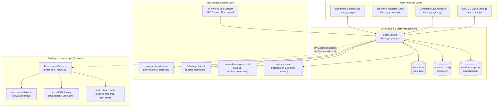
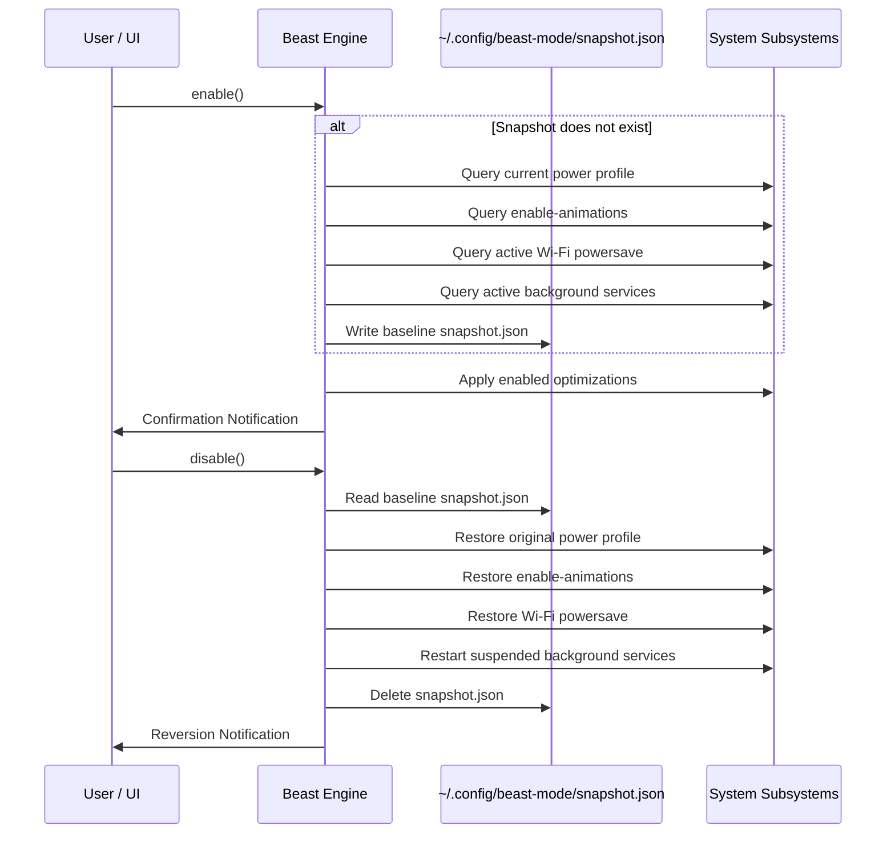

# Beast Mode System Architecture and Technical Context

## 1. Overview and Hardware Context

Beast Mode is an integrated, low-overhead system optimization suite designed specifically for HP laptops running Linux (Ubuntu 26.04 LTS, GNOME 50.1 Wayland) powered by the AMD Ryzen 5 5000-series mobile processor family.

### 1.1 Target Hardware Profile

| Hardware Component | Specification | Technical Constraints and Bottlenecks |
| :--- | :--- | :--- |
| **Processor** | AMD Ryzen 5 5500U (Zen 2 Lucienne, 6 Cores / 12 Threads)<br>Base Clock: 2.1 GHz, Max Boost: 4.056 GHz<br>TDP: 15W nominal (configurable 10W–25W cTDP) | Under standard balanced profiles, the `amd-pstate-epp` driver downclocks idle cores to ~413 MHz. During bursty workloads (e.g., agent invocations, token generation, compilation), transition latency from low P-states introduces noticeable execution delays. |
| **Physical Memory** | ~10 GiB usable DDR4 (2 GiB hardware-reserved for AMD Radeon iGPU) | 10 GiB is constrained when executing concurrent agentic runtimes, headless browser instances, and local models. In standard configuration, memory exhaustion causes the kernel to swap to an NVMe file (`/swap.img`), resulting in I/O wait stalls and UI freezing. |
| **Storage Subsystem** | 256 GB Kioxia NVMe SSD (`KBG40ZNV256G`), Controller: PCIe Gen3 x4 | Default read-ahead buffer is set to a conservative 128 KB. Standard write-back dirty page thresholds can result in write stalls during large disk bursts. |
| **Wireless Interface** | Realtek Semiconductor RTL8822CE 802.11ac PCIe (`wlo1`)<br>Kernel Driver: `rtw88_8822ce` / `mac80211` | Kernel 802.11 power saving places the transceiver into sleep states between beacon frames (100–300 ms intervals). This introduces 10–80 ms ping spikes and throughput jitter during high-concurrency network tasks. |
| **Desktop Environment** | GNOME Shell 50.1 on Wayland with Mutter Compositor | Shell and window animations (`enable-animations: true`) consume compositor frame time and GPU cycles. Background file indexers (`localsearch-3` / Tracker 3) compete for memory and disk I/O. |
| **Power Management** | AC Adapter (`ACAD`) and Primary Battery (`BAT0`) | Monitored by UPower via the system D-Bus. When running on AC power, thermal and electrical headroom allows the processor to sustain up to 25W package power and 4.05 GHz all-core boost. |

---

## 2. System Architecture



---

## 3. Subsystem Implementation Details

### 3.1 CPU and Power Scaling (100% Speed on AC)
- **Profile Driver**: Utilizes `powerprofilesctl` over D-Bus to communicate with `power-profiles-daemon`. Active desktop users possess polkit authorization to switch profiles without root credentials.
- **Governor and EPP Transitions**:
  - `balanced` (Baseline): `scaling_governor=powersave`, `energy_performance_preference=balance_power`.
  - `performance` (Beast Mode): `scaling_governor=performance`, `energy_performance_preference=performance`.
- **Dynamic AC Turbo Scaling**:
  - The engine subscribes to `org.freedesktop.UPower` D-Bus property changes (`OnBattery`).
  - **On AC Power**: Locks Core Performance Boost (`/sys/devices/system/cpu/cpufreq/boost=1`). Elevates `scaling_min_freq` across all 12 cores to 2.1 GHz base clock via the root helper, eliminating idle state transition latency.
  - **On Battery**: Retains performance governor while allowing standard idle scaling to prevent rapid battery depletion.

### 3.2 Memory and Cache Virtualization (zram & Compaction)
- **The 10 GiB RAM Bottleneck**: Heavy multi-agent workloads with local embedding models or compiling tools easily saturate 8 GiB of available RAM.
- **zram Integration**:
  - Creates an in-RAM compressed swap device `/dev/zram0` sized at 8 GB utilizing the `zstd` compression algorithm.
  - Compression occurs at memory bus speeds (20–30 GB/s), expanding effective capacity to ~18 GiB without disk swapping.
- **Swappiness and Cache Pressure Tuning**:
  - With zram: `vm.swappiness` is raised to `100`, directing anonymous pages to compressed memory before discarding file-backed caches.
  - Without zram: `vm.swappiness` is reduced to `10` to avoid premature swapping to the slower NVMe file.
  - `vm.vfs_cache_pressure` is reduced from `100` to `50` to retain directory and inode caches in memory.
- **Compaction**: Triggers `/proc/sys/vm/compact_memory` and drops stale slab caches upon activation to eliminate fragmentation.

### 3.3 Storage and NVMe I/O Tuning
- **Read-Ahead Optimization**: Scales `/sys/block/nvme0n1/queue/read_ahead_kb` from the default `128 KB` to `2048 KB`. This accelerates sequential reads during large file processing, model weight loading, and dataset indexing.
- **Write Buffer Flushing**: Reconfigures `vm.dirty_ratio` (20) and `vm.dirty_background_ratio` (10) to avoid blocking synchronous I/O operations during disk writes.

### 3.4 Wi-Fi Latency Optimization
- **Power Save Removal**: Reconfigures NetworkManager active connection setting `802-11-wireless.powersave` from `0` (default) to `2` (disabled).
- **Transceiver Persistence**: Executes `iw dev wlo1 set power_save off` to keep the Realtek radio awake, stabilizing packet response and removing 10–80 ms sleep latency.

### 3.5 Desktop Compositor and Background Daemons
- **Compositor Animation Toggle**: Disables GNOME Shell Mutter animations via `gsettings set org.gnome.desktop.interface enable-animations false`.
- **Process Suspension**: Temporarily pauses `localsearch-3.service` (Tracker 3 file indexer) and `gnome-remote-desktop.service` via `systemctl --user stop`. Reclaims ~120 MB RAM and frees storage I/O bandwidth.

---

## 4. Reversibility Protocol and State Management

To guarantee 100% reversibility, the engine executes a strict Snapshot-Before-Mutate pattern.



### Snapshot Schema (`~/.config/beast-mode/snapshot.json`)
```json
{
  "timestamp": 1792909270.578092,
  "power_profile": "balanced",
  "enable_animations": true,
  "wifi_connections": [
    {
      "uuid": "51c9014c-56d7-40c1-b665-2bec53d63d2b",
      "name": "Airtel_Homefi",
      "powersave": 0
    }
  ],
  "paused_services": [
    "localsearch-3.service",
    "gnome-remote-desktop.service"
  ]
}
```

---

## 5. Granular Configuration Schema (`~/.config/beast-mode/config.json`)

The system supports independent control of all 9 optimization features:

```json
{
  "opt_cpu_governor": true,
  "opt_cpu_ac_turbo": true,
  "opt_ram_compression": true,
  "opt_ram_compaction": true,
  "opt_wifi_low_latency": true,
  "opt_disable_animations": true,
  "opt_pause_indexers": true,
  "opt_pause_remote_desktop": true,
  "opt_storage_io": true,
  "show_resource_monitor": true
}
```

When a granular setting is toggled while Beast Mode is actively running, the engine dynamically applies or reverts only that individual subsystem in real time.

---

## 6. IPC and Privilege Isolation Architecture

### 6.1 D-Bus Integration
1. **UPower (`org.freedesktop.UPower`)**: The user service subscribes to `PropertiesChanged` on `/org/freedesktop/UPower` to monitor the `OnBattery` boolean property.
2. **AppIndicator & DBusMenu (`com.canonical.dbusmenu`)**:
   - The indicator daemon registers with `org.kde.StatusNotifierWatcher`.
   - Utilizes `libayatana-appindicator3` via Python `ctypes` to export a standard DBusMenu object at `/org/ayatana/NotificationItem/beast-mode-panel/Menu`.
   - Ensures native compatibility with Ubuntu's GNOME Shell top panel.

### 6.2 Root Helper Communication
- **Socket Path**: `/run/beast-mode.sock` (mode `0666`).
- **Protocol**: JSON-RPC over local UNIX domain socket.
- **Request Formats**:
  - `{"action": "enable", "ac_online": bool, "config": dict}`
  - `{"action": "disable"}`
  - `{"action": "update_config", "config": dict, "ac_online": bool}`
  - `{"action": "update_ac", "ac_online": bool}`
  - `{"action": "status"}`
- **Security Boundary**: The root daemon strictly validates all command inputs and only modifies pre-defined kernel/sysfs parameters. It executes no arbitrary shell commands passed from user space.
